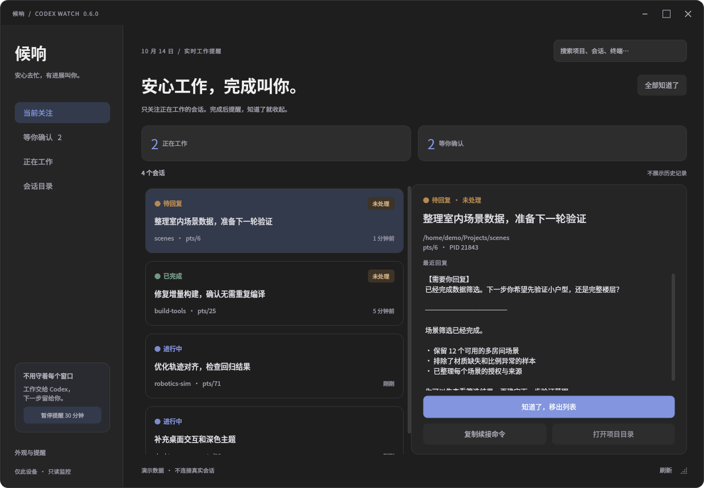
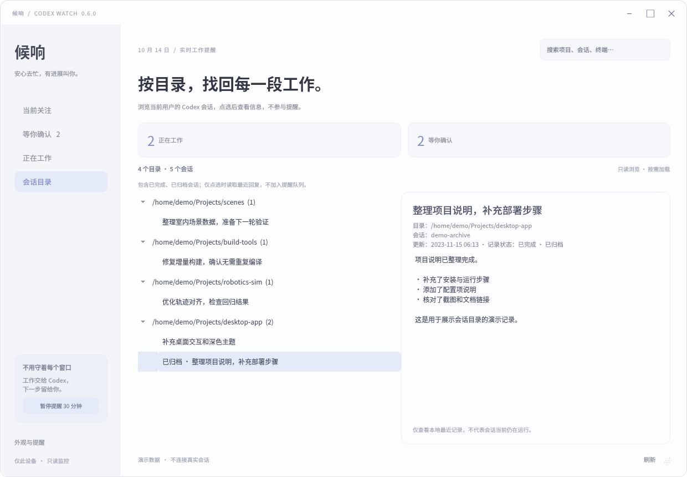
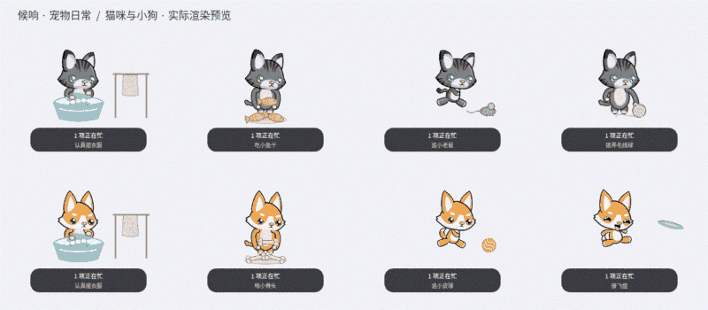
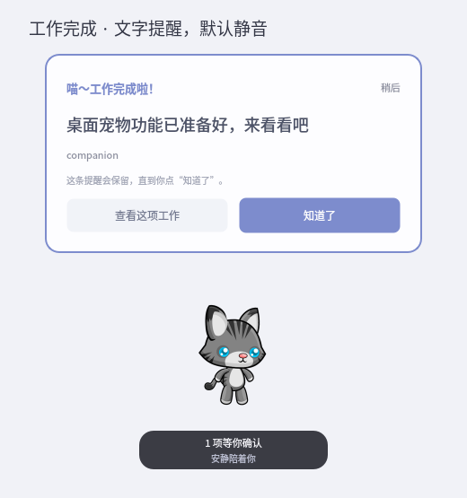

<div align="center">


# 候响 · Codex Watch

**安心工作，完成叫你。**

一个带桌面宠物的本地 Codex 任务监控器。只关注正在工作的会话，完成后提醒，确认后收起。

A local desktop companion for Codex — watch active tasks, get notified, and keep a little friend around.


[快速开始](#快速开始) · [功能](#功能) · [桌面宠物](#桌面宠物) · [兼容性](#兼容性) · [开发](#开发) · [反馈问题](https://github.com/weihaoysgs/codex-watch/issues)

</div>


## 为什么做这个

同时开着几个 Codex 窗口时，很容易忘记哪个还在工作、哪个已经完成、哪个在等回复。

候响把这件事变成一个简单的流程：

**开始工作 → 自动关注 → 完成提醒 → 点击「知道了」→ 移出列表。**

主队列不被历史记录打扰；需要回看时，可以进入独立的「会话目录」。候响不替你发送指令、不接管终端，只在轮到你处理时提醒你。

## 功能

- **只看当前工作**：自动关注运行中的会话，不把已经完成的历史记录铺满列表。
- **明确的完成提醒**：完成、需要回复、出错或中断时显示置顶卡片，不依赖系统通知横幅。
- **手动确认**：「知道了」才清除提醒；查看详情或点「稍后」不会误标为已处理。
- **桌面猫狗**：忙碌时轮换生活小动画，完成后在宠物旁显示文字气泡，默认静音。
- **后台驻留**：关闭主窗口后继续监控；支持托盘、单实例和可选登录自启动。
- **会话目录**：按完整项目路径分组，浏览当前用户所有已索引的会话（含较早和已归档记录），点选后按需读取详情，不触发提醒。
- **快速查看**：会话名称、项目目录、最近回复、问题与错误说明；支持搜索和状态筛选。
- **柔和的外观**：浅色与炭灰深色主题，可拖动宠物并记住位置。
- **本地只读**：不需要模型 API Key，不上传会话，不修改 Codex 配置或历史。

<details>
<summary>查看深色主题</summary>



</details>

## 快速开始

需要 Ubuntu 图形桌面，并且已在当前用户下使用过 Codex。候响不会替你安装或登录 Codex。

### 从源码运行

```bash
sudo apt update
sudo apt install git python3 python3-pyqt5 libqt5svg5

git clone https://github.com/weihaoysgs/codex-watch.git
cd codex-watch
./run.sh
```

**不要用 `sudo` 启动候响**，它应当读取你自己的会话并连接当前桌面。启动脚本使用系统 `/usr/bin/python3`，无需创建虚拟环境。

可选：添加应用菜单入口。

```bash
/usr/bin/python3 install.py
```

之后在应用菜单搜索 **候响** 或 **Codex Watch**。登录自启动默认关闭，可在「外观与提醒」中开启。

### 使用 Ubuntu 安装包

从 [GitHub Releases](https://github.com/weihaoysgs/codex-watch/releases) 下载 `.deb` 或分享 ZIP。升级前请先从托盘退出旧版，再安装并重新启动：

```bash
sudo apt install ./codex-watch_0.6.1_all.deb
codex-watch
```

仓库不跟踪构建产物，也可以在本地生成 `.deb` 和分享用 ZIP：

```bash
/usr/bin/python3 packaging/build_deb.py
sudo apt install ./dist/codex-watch_0.6.1_all.deb
codex-watch
```

打包需要 `dpkg-deb`（Ubuntu 通常已安装），不需要重新下载宠物素材。安装包仅包含显式列出的程序与素材文件，不包含本机配置和会话。

完整安装、升级和卸载步骤见 [Ubuntu 安装说明](packaging/INSTALL.zh-CN.md)。

## 使用方式

1. 打开候响，照常在终端使用 Codex；已经运行的任务也会被识别。
2. 在 **当前关注** 或 **正在工作** 中查看运行状态。
3. 收到提醒后，点 **查看这项工作** 阅读详情，回到原终端处理。
4. 点 **知道了**，这条事项便移出队列；同一会话开始下一轮时会重新加入。

「知道了」只清除候响里的提醒，**不会关闭或终止 Codex**。

| 操作 | 效果 |
| --- | --- |
| 关闭主窗口 | 隐藏到托盘继续监控；无可用托盘时最小化 |
| 点击「稍后」 | 收起当前卡片，保留待确认事项 |
| 暂停提醒 | 暂停 30 分钟，期间继续记录状态 |
| 未处理提醒 | 默认每 10 分钟汇总提醒，可在设置中关闭 |
| `Ctrl+K` / `Ctrl+R` | 搜索 / 刷新 |
| `Ctrl+Q` 或托盘「退出候响」 | 完全退出 |

提醒卡片不主动抢键盘焦点。有宠物时出现在宠物旁，收起宠物后显示独立卡片。系统勿扰可能隐藏辅助系统通知，但不会隐藏候响自己的卡片；需要安静时使用候响的暂停功能。

## 会话目录

左侧 **会话目录** 提供独立的只读浏览视图：

- 按完整工作目录分组，显示目录下的会话数量。
- 包含当前用户 Codex 索引中的较早、已完成及已归档用户会话，不列出内部子代理。
- 点击会话查看名称、目录、ID、更新时间、最近记录状态与回复。
- 顶部搜索可按目录、会话名称或 ID 筛选；点击「刷新」重新读取。
- 仅在点选时读取该会话内容；不会启动、恢复、修改或删除会话，也不会改变提醒队列。

此处显示的是本地最近记录，不等于该会话此刻仍在运行。读取范围为当前用户的 `CODEX_HOME`，不扫描其他系统用户的私有目录。



## 桌面宠物



| 小猫 | 小狗 |
| --- | --- |
| 搓洗衣服、泡泡与晾衣架 | 搓洗衣服、泡泡与晾衣架 |
| 拿起小鱼干、咀嚼 | 拿起骨头、啃咬 |
| 追老鼠、扑跳 | 追弹跳的小球 |
| 拨弄毛线球 | 跳起接飞盘 |
| 跑步、散步、跳跃 | 跑步、散步、跳跃 |

- 工作期间自动轮换活动；没有任务时安静待机。
- **拖动**移动位置，**单击**查看提醒或当前任务。
- **右键 → 让它做点什么**，点播一个动作 12 秒；不会改变真实任务状态。
- 右键切换猫狗或收起；收起宠物不影响完成提醒。
- 完成时文字气泡提醒，默认不出声；需要提示音可自行开启。

生活场景由现有 CC0 角色与本项目的关节动作、矢量道具组合实现。宠物活动仅用于陪伴，不表示 Codex 正在执行同名操作。

<details>
<summary>查看完成提醒</summary>



</details>

## 兼容性

最低运行依赖：**Python 3.8、PyQt5 5.14**。当前适配 Linux `/proc` 和本地 Codex 数据，未提供 Windows / macOS 版本。

| 环境 | 验证情况 |
| --- | --- |
| Ubuntu 20.04 | 容器内原生 Python 3.8.10 / PyQt5 5.14.1 / Qt 5.12.8；安装、57 项测试及 Xvfb 中真实 Fcitx 拼音输入通过，完整 GNOME 桌面尚未实测 |
| Ubuntu 22.04 / X11 | 已验证实际桌面宠物、置顶提醒、完成与确认流程；Qt 5.15.3 下在隔离 Xvfb 中验证真实 Fcitx 和 IBus 拼音输入 |
| Ubuntu 24.04 / Wayland | 尚未独立实测；窗口定位、置顶与托盘行为可能不同 |
| ARM64 | 安装包为架构无关的 Python 包，但尚未实机验证 |

已验证的 Codex 环境包含 **0.159.2**。候响读取的是本地 SQLite / JSONL 数据格式，而不是稳定的公共 API；Codex 更新后可能需要适配。

### 状态判断与限制

- 不会仅凭一条回复或一段静默就判断完成；优先使用明确的任务事件。
- 同时识别独立 CLI 与共享 app-server，兼容内部来源标为 `vscode` 的用户会话。
- 交互问题与审批只有在日志中存在可识别事件时才能显示，不能保证覆盖所有版本。
- 共享后台不总能对应到具体终端标签页；此时按会话名称展示，不猜窗口编号。
- 不自动切换既有终端、不发送按键；「复制续接命令」只复制，不执行。
- 退出期间无法实时弹窗；已跟踪任务的未确认记录会在重启后恢复。

## 数据与隐私

默认读取 `~/.codex`；如果使用了其他目录：

```bash
CODEX_HOME=/path/to/your/codex ./run.sh
```

读取范围包括会话索引、轮次数据库、JSONL 日志，以及 `/proc` 中的会话关联。数据库以只读方式打开，回复预览使用纯文本。

**不读取 `auth.json`，不修改 Codex 数据，不上传会话内容，不调用模型 API。**

候响自己的偏好和确认标记保存在 `~/.local/share/codex-watch/`，可通过 `XDG_DATA_HOME` 更改位置；状态文件权限为 `0600`。不要把该目录或真实诊断输出提交到仓库。

## 常见问题

**Ubuntu 20.04 安装时提示 Python / PyQt5 版本不足？**

使用 **0.5.1 或更新版本**。旧包的最低版本要求过高；无需替换系统 Python 或强制安装旧包。

**搜索框无法正常输入中文，拼音被截断或提前选词？**

请退出旧进程并升级到 **0.6.1 或更新版本**。已修复列表刷新打断输入法组词的问题；组词期间继续监控和提醒，中文提交或取消后再更新搜索结果。

如果完全没有候选框，而且其他 Qt 应用也无法输入中文，请检查所用输入法的 Qt5 插件：Fcitx 4／搜狗通常需要 `fcitx-frontend-qt5`，Fcitx 5 需要 `fcitx5-frontend-qt5`。只安装与你正在使用的框架对应的插件，不需要更换输入法或系统 Python。IBus 的 Qt5 插件由系统 Qt 提供。输入法环境变量的说明见 [Fcitx 官方配置文档](https://fcitx-im.org/wiki/Input_method_related_environment_variables)。

**没有检测到任务？**

确认当前用户已经使用过 Codex，检查 `CODEX_HOME`，再运行 `./run.sh --diagnose`。如果 Codex 更新后出现问题，请提供版本和脱敏后的复现信息。

**完成后没有提醒？**

确认候响仍在运行，通知开关已开启且没有暂停提醒；可在设置中使用「预览完成提醒弹窗」。锁屏、全屏程序和桌面合成器可能影响显示。

**如何升级？**

先退出候响。源码安装在仓库中执行 `git pull --ff-only` 后重新启动；`.deb` 安装使用 `sudo apt install ./新版.deb`。用户设置和确认记录保留。

## 开发

```bash
# 回归测试：使用临时数据，不需要真实 Codex 账号
QT_QPA_PLATFORM=offscreen /usr/bin/python3 -m unittest discover -s tests -v

# 使用演示数据预览界面
./run.sh --demo
./run.sh --demo --dark

# 生成演示截图
QT_QPA_PLATFORM=offscreen ./run.sh --demo --screenshot /tmp/codex-watch.png

# 构建本地安装包
/usr/bin/python3 packaging/build_deb.py
```

Ubuntu 20.04 隔离兼容验证：

```bash
/usr/bin/python3 packaging/build_deb.py
docker build -f packaging/Dockerfile.ubuntu20 -t codex-watch-test-ubuntu20 .
docker run --rm --network none codex-watch-test-ubuntu20
```

已有宠物图集随源码提供；只有重新处理原始素材或生成动画预览时，才需要 `python3-pil`。普通运行不依赖 Pillow。

```text
native/
  core.py          只读会话适配与提醒队列
  main.py          主窗口、托盘、设置与生命周期
  history.py       按目录分组的只读会话浏览
  search.py        输入法组词与安全延后重绘
  reminder.py      独立置顶提醒卡片
  pet.py           桌面宠物与任务状态联动
  pet_scenes.py    生活场景动作与道具
  assets/pets/     本地猫狗图集与来源说明
packaging/         Ubuntu 打包与兼容验证
tests/             状态、界面与宠物回归测试
doc/               仅演示数据的项目截图
```

提交问题或改动前，请阅读 [开发与反馈指南](CONTRIBUTING.md)。版本变化见 [CHANGELOG](CHANGELOG.md)。

## 致谢与许可证状态

- 猫狗角色来自 **pzUH / GameArt2D** 的 [Cat & Dog - Free Sprites](https://opengameart.org/content/cat-dog-free-sprites)，标注为 **CC0**；详见 [第三方素材说明](native/assets/pets/THIRD_PARTY_NOTICES.md)。
- 图形界面基于 [PyQt5](https://www.riverbankcomputing.com/software/pyqt/intro) 与 Qt，第三方组件各自的许可独立适用。
- **本项目暂未添加项目级许可证**，不将源码公开等同于已授予通用开源许可。

这是独立社区项目，与 OpenAI 无隶属关系，也不是官方 Codex 产品。
